# ATLAS · Martian Map

**A layered 3D map of Mars, built on real NASA data, that helps the first human explorers plan a safe Marswalk and survive the mission around it.**

NASA Space Apps Challenge 2026 · **Team Protikriti** · Challenge: [*Interplanetary Survival Guide: Martian Map*](https://www.spaceappschallenge.org/) (Human Exploration · Mars · Software)


> **The challenge:** build a layered, integrated view of a location or route on the Martian surface that pulls together data from multiple NASA science missions, to help a human explorer plan a successful Marswalk while doing new science along the way.

🌐 **Live app: [atlas-mars.vercel.app](https://atlas-mars.vercel.app)**

🎬 **Videos:** 240-second demo (coming soon) · [30 Seconds of Glory](https://youtu.be/RkVXGQ8JbPg)

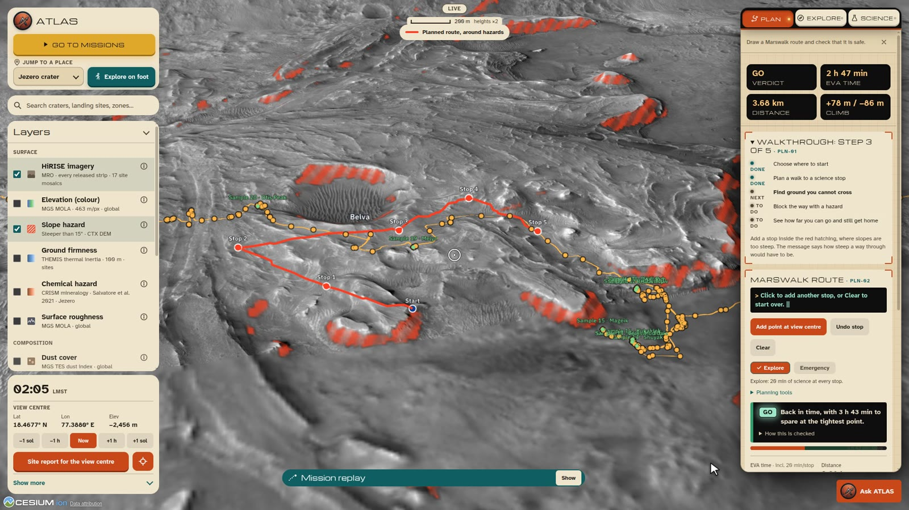

ATLAS has two modes. **Map Mode** is the explorer's toolkit: a 3D Mars from orbit down to the ground, 360° rover panoramas, site reports, a Marswalk planner that checks every leg and the walk home, and an EVA console. **Mission Mode** is a story you learn through: a crew of four must survive 525 sols, based on NASA's own Mars mission plan, and every decision carries forward. **Ask ATLAS** explains whatever is on screen and cites a source for every number.

## Contents

[Features](#features) · [Feature clips](#feature-clips) · [Controls](#controls) · [Install](#install) · [For young explorers](#for-young-explorers-) · [How it works](#how-it-works) · [Data](#data) · [Project structure](#project-structure) · [Quality](#quality) · [Team](#team-protikriti) · [Limitations](#limitations) · [Credits](#credits)

## Features

### Map Mode

| | Feature | What you can do |
|---|---|---|
| 🌍 | **Whole-planet 3D globe** | Spin all of Mars on MOLA topography, with high-resolution terrain at Jezero and Gale. Search 2,052 IAU-named places, 16 lander sites and NASA's 30 candidate Exploration Zones. Every view has a shareable link. |
| 🏕️ | **Site reports and colony suitability** | Click anywhere for a site report: colony outlook dials (sun, ice, minerals, shelter, stability, calm), sky and climate charts, ground, water ice (SWIM), radiation measured by Curiosity, daylight and nearby discoveries. A live radar chart scores the view centre, and the 30 Exploration Zones can be ranked by what matters most to you. |
| 🔬 | **What the rovers found** | Curiosity's and Perseverance's latest weather, and every sealed Perseverance rock sample with its NASA record, a HiRISE map snapshot of where it was taken and a link to the 360° panorama there. |
| 🥾 | **Safe Marswalk planner** | Click a start and science stops. Each leg is the fastest route that never crosses ground steeper than 15°. The EVA card says GO or NO-GO by checking, at every point, that the crew can still walk home within the EVA limit, and shows where and by how much a plan fails. Mark an obstacle and the route goes around it, with the detour's cost. Walking-range rings, line of sight, signal delay to Earth for any date, and a benchmark against 556 real Perseverance drives. |
| ⌚ | **EVA console** | A wrist console that guides the crew stop by stop: oxygen, battery, slope, return time, nearby places, the height profile and alerts. |
| 📷 | **360° rover panoramas** | Stand at 2,000+ Perseverance and Curiosity stops and look around panoramas stitched from NASA Navcam images, with walk arrows to the next stop. |
| 🧠 | **Labelled terrain** | An experimental model trained on NASA's AI4Mars labels marks sand, soil, bedrock and big rocks in the panoramas. |
| 🎮 | **Explore on foot** | Walk the real terrain at true scale around the base you built: Mars gravity, a dusty sky that turns blue at sunset, dust devils, and wind, temperature and dust that follow rover weather records for the season and hour. A field tablet shows suit, weather, terrain and navigation, and you can replay the 2018 global dust storm. |
| 🚙 | **Pressurized rover** | Board the rover and drive to real scientific places along a trail drawn on the ground. |
| 🗺️ | **Science layers** | Every released HiRISE strip (down to ~25 cm/px) and 17 HiRISE site mosaics, CTX, MOLA colour elevation, slope hazard, ground firmness (THEMIS), CRISM minerals, TES dust, roughness and a lat/lon grid. |
| ⏱️ | **Mars clock and mission replay** | Local solar time, sols, season and the real sun. Replay both rovers' journeys sol by sol. |
| 📴 | **Works offline** | A Live / Offline badge; everything you have visited keeps working without internet. |

### Mission Mode

A crew of four must survive **525 sols** on Mars, based on NASA's Design Reference Architecture 5.0. Each mission plays on the real map with 3D scenes and sourced numbers, and what you choose carries forward: pack too few reactors at launch and, months later, the greenhouse goes dark.

| Act | Missions |
|---|---|
| **Arrive** | 1.1 Briefing and cargo · 1.2 Choose the landing site · 1.3 Landing |
| **Walk out** | 1.4 Build the base · 1.5 First Marswalk |
| **Stay** | 1.6 Greenhouse trial · 1.7 Dust storm · 1.8 Water from ice |
| **Go far** | 1.9 Long traverse · 1.10 Power unit failure |
| **Leave something behind** | 1.11 Return window |
| **The second crew** | 2.1 Pack the second lander · 2.2 Wake the base · 2.3 Greenhouse scale-up · 2.4 Ice mining at scale · 2.5 Cave scouting · 2.6 Sample campaign · 2.7 Return |

Every attempt writes a **mission report** to the archive, so the crew can trace a mistake, change the plan and try again. A bad plan costs nothing here: it fails on screen, not on Mars.

### Ask ATLAS

An assistant that explains what is on screen using the app's own numbers and sources. It never computes: every number in an answer is checked against the app's data, and each one cites its source ([S1], [S2] …). Stuck on a NO-GO? Ask ATLAS what to change.

## Feature clips

<table>
<tr>
<td width="50%">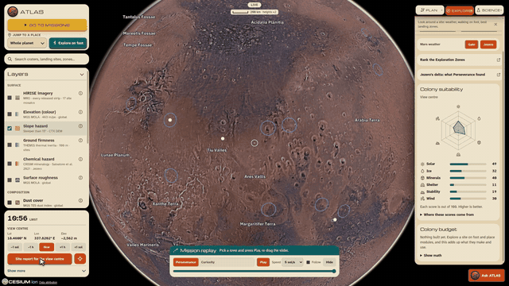<br><sub><b>Site report</b> · colony outlook, sky and climate, ground, water and radiation</sub></td>
<td width="50%">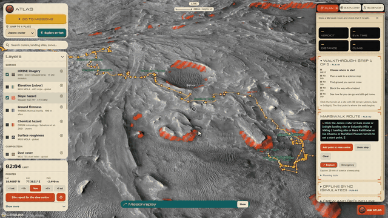<br><sub><b>Marswalk planner</b> · a winding route at Belva crater, Jezero, checked to GO</sub></td>
</tr>
<tr>
<td>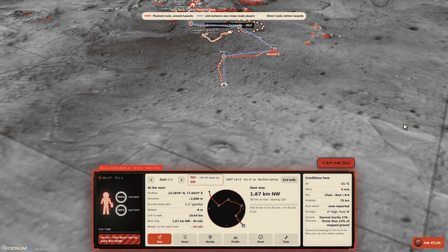<br><sub><b>EVA console</b> · oxygen, battery, slope, return time and alerts</sub></td>
<td>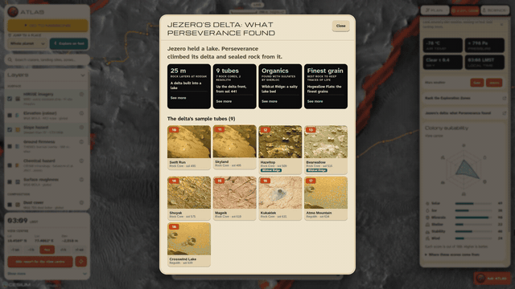<br><sub><b>Nearby discoveries</b> · a Perseverance sample and where it was taken</sub></td>
</tr>
<tr>
<td>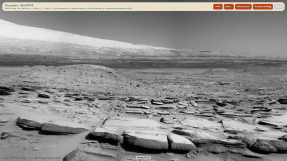<br><sub><b>360° panorama</b> · Curiosity Navcam, sped up</sub></td>
<td>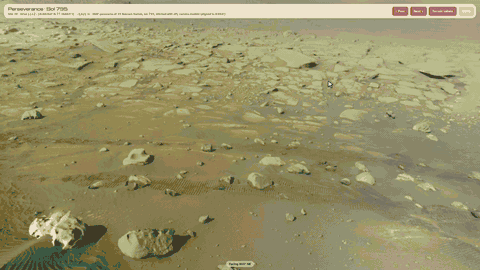<br><sub><b>Labelled terrain</b> · a model trained on AI4Mars</sub></td>
</tr>
<tr>
<td>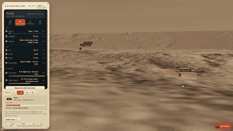<br><sub><b>Explore on foot</b> · from the base to the solar arrays at Gale</sub></td>
<td>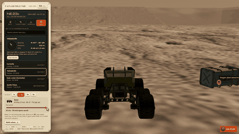<br><sub><b>Pressurized rover</b> · following the trail to a science stop</sub></td>
</tr>
<tr>
<td>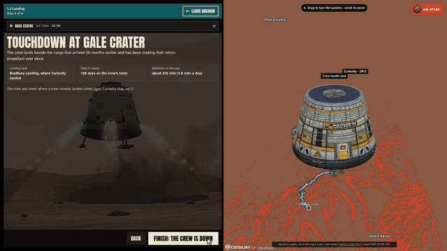<br><sub><b>Mission Mode</b> · 1.3 Landing at Gale crater</sub></td>
<td>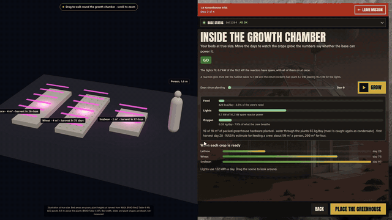<br><sub><b>Mission Mode</b> · 1.6 Greenhouse trial</sub></td>
</tr>
<tr>
<td>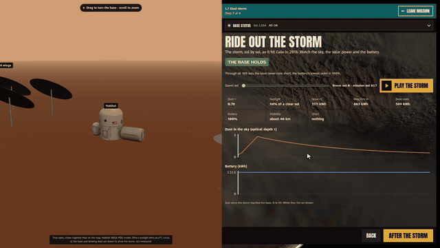<br><sub><b>Mission Mode</b> · 1.7 Dust storm</sub></td>
<td>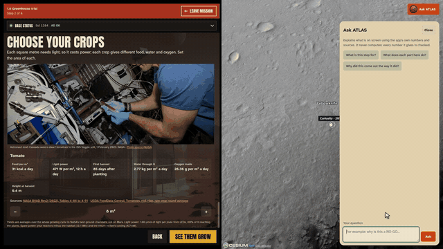<br><sub><b>Ask ATLAS</b> · answers cite their sources</sub></td>
</tr>
</table>

## Controls

| Where | Action | How |
|---|---|---|
| **Map** | Rotate / zoom / tilt | Drag · scroll · Ctrl + drag (zoom stops 20 m above the ground) |
| | Fly to HiRISE imagery | Search a site name, e.g. "Opportunity", "Viking 1" or "Ares 3" |
| | Site report | Right-click the ground, or **Site report for the view centre** |
| | Open a 360° panorama, a weather station or a sample | Click its marker (panorama cameras appear when you zoom within ~150 km) |
| **360° panorama** | Look around / zoom | Drag or arrow keys · scroll or `+` `-` |
| | Next stop | Click an arrow on the ground, or **Prev** / **Next** |
| | Leave | `Esc` or **Close** |
| **Explore on foot** | Walk / strafe / turn | `W` `S` or `↑` `↓` · `A` `D` · `←` `→` |
| | Run / jump | Hold `Shift` · `Space` |
| | Time of day | Set the map clock before you go (`+1 h`, `+1 sol`) |
| | Look | Drag |
| | Leave | `Esc` |
| **Pressurized rover** | Board / leave | `F` beside the rover |
| | Drive / steer | `W` `S` · `A` `D` |
| **Marswalk** | Plan a walk | **Plan** tab, then click a start and stops on Jezero or Gale terrain |
| | Walk it | **Start the walk** opens the EVA console |
| **Mission Mode** | Play a mission | **Mission mode** on the start screen, then **Play** on any mission |
| **Anywhere** | Ask a question | **Ask ATLAS** (bottom right) |

## Install

Tested on Ubuntu Linux. macOS works the same way. On Windows, use WSL (the data scripts need `bash` and `make`).

### 1. Install the tools (once per computer)

| Tool | Version | Why |
|---|---|---|
| [Git](https://git-scm.com/downloads) | any | download the code |
| [Node.js](https://nodejs.org/) | 20.19+ or 22.12+ | runs the website (Vite 8) |
| [uv](https://docs.astral.sh/uv/getting-started/installation/) | any recent | runs the Python data pipeline; it installs Python 3.12 for you |
| `make` and `curl` | any | one-command setup |

- **Ubuntu / Debian / WSL:**
  ```bash
  sudo apt update && sudo apt install -y git make curl
  curl -fsSL https://deb.nodesource.com/setup_22.x | sudo -E bash - && sudo apt install -y nodejs
  curl -LsSf https://astral.sh/uv/install.sh | sh    # then open a new terminal
  ```
- **macOS** (with [Homebrew](https://brew.sh)):
  ```bash
  xcode-select --install          # git, make and curl
  brew install node uv
  ```
- **Windows:** open PowerShell as administrator, run `wsl --install`, restart, open the **Ubuntu** app and follow the Ubuntu steps above. Keep the project inside the Ubuntu home folder (not `C:\`), or it will be slow.

Check everything is there:

```bash
git --version && node --version && uv --version && make --version | head -1
```

### 2. Get the code

The repository is public, so no invitation is needed. Then:

```bash
git clone https://github.com/AhsanulHoque22/Nasa-Space-Apps-Challenge-2026-Team-Protikriti.git martian-map
cd martian-map
```


### 3. Install, download the data, run

```bash
make install   # Python and JavaScript dependencies
make data      # downloads ~170 MB of NASA/USGS data and builds the map files (several minutes)
make dev       # starts the app
```

Open **http://localhost:5173** in Chrome, Edge or Firefox (WebGL2 is required). Stop the app with `Ctrl+C`.

`make data` only needs to run once. It skips files it has already downloaded, so re-running it after an interrupted download is safe.

### Other commands

```bash
make test lint   # pytest + vitest, ruff + mypy --strict + eslint + tsc + prettier
make build       # production build in web/dist
cd web && npm run preview   # serve that build at http://localhost:4173
```

### Deploy to Vercel

Every push to `main` deploys https://atlas-mars.vercel.app: the Vercel project `atlas-mars` is connected to this repository and builds it with the root `vercel.json` (`npm run build` in `web/`, serving `web/dist`). The generated map data in `web/public/data/` is committed, so the build needs nothing else. After changing data, run `make data` and commit what it writes.

### Offline demo

The production build registers a service worker that saves what you look at: the app, its data, map tiles and NASA responses. Before a demo, open the deployed site once online, visit every place you will show (a site, a panorama stop, a weather panel), then turn wifi off and reload: it works from the saved copy. A **Live / Offline** badge at the top shows which you are looking at. Only places seen online are saved; anything new stays blank offline. The development server does not register the worker.

### Troubleshooting

| Problem | Fix |
|---|---|
| `uv: command not found` | Open a new terminal after installing uv, or run `source ~/.bashrc` (Linux) / `source ~/.zshrc` (macOS). |
| `npm ci` fails with an engine or syntax error | Node is too old: `node --version` must be 20.19+ or 22.12+. |
| The map says `HTTP 404 (did you run make data?)` | Run `make data` from the project folder, then refresh the page. |
| `make data` stops with a `curl` error | A NASA server was busy. Run `make data` again; it resumes where it stopped. |
| A panorama says NASA's service did not answer | NASA's raw-image API is sometimes slow. Press **Try again**. |
| A panorama shows separate photos instead of one smooth panorama | The page isn't served by `make dev` or `npm run preview`, so the `/nasa-raw` image proxy is missing (see Architecture). |
| A black screen or "WebGL2 is not available" | Turn on hardware acceleration in the browser settings, or try another browser. |

## For young explorers 🚀

*A guide for kids and the grown-up helping them. You need about 30 minutes and an internet connection.*

### Part 1: the grown-up sets it up

Setting up is the only tricky part, so a grown-up should do it. Follow **Install** above, steps 1 to 3. After the first time, starting the app is just two commands:

```bash
cd martian-map
make dev
```

Then open **http://localhost:5173**. Tip: bookmark it!

### Part 2: your mission, explorer

You are planning the first human walk on Mars. Everything you see is real data from NASA robots and satellites.

1. **Spin the planet.** Drag to turn Mars, scroll to zoom. Mars is red because its dust is rusty!
2. **Find a famous place.** Type **Olympus Mons** in the search box. It's the tallest volcano in the whole solar system, about 2.5 times as tall as Mount Everest.
3. **Visit a robot.** Press the **Jezero** button at the top to fly to the crater where the Perseverance rover landed in 2021. The orange line is the path it drove.
4. **See through the rover's eyes.** Zoom in close to the orange line and click a camera dot. You are now standing where Perseverance stood! Drag to look around, click the arrows on the ground to drive to the next stop, and press `Esc` to leave.
5. **Check the weather.** Press **Gale** under *Mars weather*. Is it colder than your freezer? (Hint: almost always!)
6. **Go for a walk.** Press **Jezero** under *Explore on foot*. Walk with `W` `A` `S` `D` or the arrow keys, run with `Shift`, jump with `Space` (you float, because Mars gravity is only 38% of Earth's) and look around by dragging. Press `Esc` to stop.
7. **Plan a safe Marswalk.** In the *Marswalk route* panel, press **Add point at view centre**, move the map, and add a few more stops. The app finds a path that avoids the red hatched areas, which are too steep to walk on safely.
8. **Travel in time.** At the bottom, press **Play** in *Mission replay* and watch the rover's whole journey, sol by sol. (A *sol* is one Mars day: 24 hours and 40 minutes.)
9. **Lead a mission.** Go back to the start screen and choose **Mission mode**. Pack the lander, pick where to land and keep your crew alive. If a plan fails, read the mission report, change one thing and try again. Stuck? Press **Ask ATLAS**.

**Challenge:** find a Perseverance rock sample (try searching **Sample**) and visit it in its 360° panorama. Can you see the rock the rover drilled?

**Stay safe online:** only open links a grown-up says are OK, and ask before downloading anything.

## How it works

- **Routing.** A* over the site's elevation grid, costed by walking time: Tobler's hiking function times a 0.8 suit factor, capped at 3.3 km/h. Any cell steeper than 15° is impassable, so routes go around hazards rather than along their edges. The walking-range overlay floods the same search over the whole grid, out and back, so it cannot disagree with the router. It runs in a Web Worker; a 10 km route takes about 0.3 s.
- **360° panoramas.** From all Navcam frames at a stop, the viewer keeps the imaging sequence with the widest sweep and drops repeated shots. A worker then stitches them into one equirectangular sphere (`web/src/core/stitch.ts`):
  1. pinhole projection through the mast's pointing (sensor tiles are windows of one camera), turned to compass bearings with the rover's heading;
  2. lens-vignetting correction and Brown & Lowe gain compensation between frames;
  3. feathered blending across seams;
  4. push-pull pyramid filling for sky and ground no frame saw.

  WebGL2 draws the result.
- **Mars time.** The NASA GISS Mars24 algorithm gives the Mars Sol Date, local solar time, solar longitude (season) and the sun's position. Rover sols are checked against NASA's own raw-image sol numbers.
- **Coordinates.** Everything uses the Mars 2000 sphere (radius 3,396,190 m), planetocentric latitude and east longitude, the same frame as the source data, so readouts are exact.

## Data

Every dataset is open and cited in full, with product IDs and URLs, in **[docs/data-sources.md](docs/data-sources.md)**.

Two NASA archives serve most of it:

- **[NASA Mars Trek](https://trek.nasa.gov)** (NASA/JPL-Caltech): the map imagery and global layers, through its WMTS: Viking MDIM 2.1 colour mosaic, the HiRISE global mosaic and 17 HiRISE site mosaics, the CTX Gale mosaic, the MOLA colour hillshade, the TES dust cover index and MOLA roughness.
- **[NASA Planetary Data System (PDS)](https://pds.nasa.gov)**, Geosciences Node: MGS MOLA MEGDR global topography (`megt90n000cb`). Also from PDS: the USGS Mars Global Cave Candidate Catalog, the HiRISE stereo DTMs and the Spirit traverse.

| Dataset | Mission / instrument |
|---|---|
| Global topography | Mars Global Surveyor · MOLA MEGDR (NASA PDS Geosciences Node) |
| Jezero and Gale terrain | MRO CTX DEM, 20 m · USGS MSL Gale Merged DEM 1 m · Mars 2020 TRN HiRISE DTM · HiRISE DTEEC (PDS) |
| Imagery | MRO HiRISE (25 cm) · CTX · Viking MDIM, via NASA Mars Trek |
| Rover tracks and stops | NASA/JPL MMGIS traverses and waypoints |
| 360° panoramas | Perseverance and Curiosity Navcam raw images (NASA Raw Images API) |
| Terrain labels | AI4Mars (NASA/JPL, Swan et al. 2021) |
| Weather | Curiosity REMS · Perseverance MEDA (NASA Mars Weather API) |
| Buried ice | SWIM 2.0 (Morgan et al. 2021) |
| Minerals | MRO CRISM mineral map of Jezero (Salvatore et al. 2021) |
| Ground firmness | Mars Odyssey THEMIS thermal inertia (USGS) |
| Radiation | Curiosity RAD (Hassler et al. 2014) |
| Dust | MGS TES dust index (Mars Trek) · Montabone et al. dust scenarios (LMD) |
| Time and sun | NASA GISS Mars24 · JPL planet positions |
| Place names | IAU / USGS Gazetteer of Planetary Nomenclature |
| Cave candidates | USGS Mars Global Cave Candidate Catalog (PDS) |
| Exploration Zones | NASA 2015 First Landing Sites workshop (LPI Contribution 1879) |
| Mission science | NASA DRA 5.0 · NASA BVAD 2022 · Rucker et al. 2016 · NASA-STD-3001 |
| Samples and rover model | NASA Mars Rock Samples · NASA 3D Resources |

## Project structure

```
NASA MOLA · USGS DEMs ─┐                              ┌─ sites/*/grid.bin + slope_hazard.png ─┐
IAU gazetteer          ─┤                              ├─ mola.bin · swim.bin                  │
JPL MMGIS              ─┼─ pipeline/  (Python 3.12) ───┼─ layers/*.geojson · stops/*.json      ├─ web/  (TypeScript + CesiumJS, static site)
SWIM · REMS/MEDA       ─┤   python -m marsmap …        ├─ activities.json                      │    live: NASA weather + raw-image APIs
curated JSON           ─┘                              └─ weather/ snapshots                   ┘
```

| Path | What lives there |
|---|---|
| `pipeline/src/marsmap/` | Data pipeline CLI: `sites`, `mola`, `swim`, `layers`, `stops`, `activities`, `weather`. `make data` runs them all. |
| `pipeline/data/` | Curated inputs: site list, landing sites, Exploration Zones, rock samples |
| `web/src/core/` | Pure, unit-tested logic: routing, Mars time, weather, search, panorama selection and stitching |
| `web/src/map/` | CesiumJS globe, layers, terrain, workers, WebGL panorama renderer |
| `web/src/ui/` | Panels and dialogs: search, layers, route, weather, clock, panoramas, explore on foot, EVA console, site report, Ask ATLAS |\n| `web/src/ui/missions/` | Mission Mode: one file of steps (and views) per mission |\n| `api/explain.ts`, `web/src/server/` | The Ask ATLAS endpoint (a Vercel function) and its source-checking logic |
| `docs/` | Data sources, AI use, feature clips, design specs and plans |

The app is static files plus live calls to NASA's open APIs, and one small serverless function for Ask ATLAS. Panoramas, terrain labels and 1 m terrain tiles beyond the demo set come from the team's own file server (`VITE_PANO_CDN`); without it the app falls back to the coarser site grids. Panorama stitching reads NASA image pixels through a same-origin `/nasa-raw` → `https://mars.nasa.gov` proxy (built into `npm run dev` and `npm run preview`). The live site runs on Vercel, where the root `vercel.json` provides the same rewrite. A static host without it falls back to unstitched photos.

## Quality

- **1,338 automated tests:** 198 Python (pytest) and 1,140 TypeScript (Vitest) across 158 test files, covering slope, DEM I/O, layer building, A* routing, the EVA return check, Mars time, weather parsing, panorama selection and stitching, every mission's rules, and the Ask ATLAS number check.
- **Strict checks:** `ruff`, `mypy --strict`, ESLint (strict), `tsc --noEmit` and Prettier. CI runs `make lint test` on every push.
- **Responsive by design:** routing and panorama stitching run in Web Workers; NASA API calls retry with backoff.
- **Accessible:** keyboard-operable, labelled controls; hazards are hatched, never shown by colour alone.
- **Honest numbers:** every number traces to a dataset or is marked as a team assumption in [docs/data-sources.md](docs/data-sources.md). How AI was used is in [docs/AI_USE.md](docs/AI_USE.md).

Engineering standards: [CLAUDE.md](CLAUDE.md) · Product and design brief: [PRODUCT.md](PRODUCT.md) · Plans and specs: [docs/superpowers](docs/superpowers)

## Team Protikriti

| Name | Role | Contribution |
|---|---|---|
| Ahsanul Hoque | System Designer & AI Engineer | Brainstorming; full development of the app |
| Md. Shaeakh Ahmed Chowdhury | System Architect | Brainstorming; development of Expedition 2; video editing |
| Muntaha Monir | Resource Intelligence Analyst | Brainstorming; research |
| Most. Zannatun Nesa Prima | UX, Visualization & Presentation Lead | Idea generation; research |
| Anika Tahsin Orthi | Planetary Science Researcher | Idea generation; research |
| Mohammad Omar Faruk | Data Pipeline & Geospatial Engineer | Research |

## Contributing (team workflow)

- **Repo owner:** commits directly to `main`.
- **Teammates:** create your own branch from the latest `main` (`git switch main && git pull && git switch -c <your-name>/<short-topic>`), push it, and open a pull request into `main`.
- **Everyone:**
  - Follow [CLAUDE.md](CLAUDE.md), our engineering standards: write the failing test first, keep functions small, and put units in names.
  - Run `make lint test` before pushing.
  - Never commit downloaded data (`data/raw/`) or secrets (`.env`).

## Limitations

Known and deliberate:

- **Walking pace is a team assumption.** Tobler's function (an Earth model) times a 0.8 suit factor, capped at 3.3 km/h. None of the three numbers is yet tied to a NASA citation, and Mars gravity is not modelled. They are named constants in `web/src/core/route.ts`.
- **Slope maps resolve 20–32 m.** Boulders and small scarps are not in the model, so a real EVA needs 1 m HiRISE DTM checks.
- **Routes only inside the two high-resolution sites.** Elsewhere the terrain is global MOLA (about 15 km per pixel).
- **Perseverance weather is archival.** MEDA's public feed stopped updating in April 2024; Curiosity's REMS is live.
- **Panorama exposure is approximate.** Lens vignetting is corrected with one fitted exponent, not the per-camera flat field, so faint brightness steps can remain at some seams.
- **Exploration Zones sit on their named IAU feature** (or the abstract's coordinates), not on the exact proposal polygons.
- **Science-stop time is a planning assumption** (20 min per stop), not mission data.

## Credits

Background music: 240-second video, **The_Mountain** on Pixabay (https://pixabay.com/users/the_mountain-3616498/), under the Pixabay Content License; 30-second video, https://youtu.be/YGUY2Iq6qkA. The astronaut dust-storm clip that opens the 30-second video was generated with Gemini Argon (see [docs/AI_USE.md](docs/AI_USE.md)).

Imagery and data © NASA/JPL-Caltech, USGS Astrogeology, MSSS, University of Arizona (HiRISE) and the IAU. Built with [CesiumJS](https://cesium.com/platform/cesiumjs/), [Vite](https://vite.dev/), [rasterio](https://rasterio.readthedocs.io/) and [uv](https://docs.astral.sh/uv/).
